# Peter Thiel Network (from The Nerd Reich)

**Legend:** red dashed border = echoes Thiel-style anti-democracy / exit views as described in the book; hexagon = network state, startup city or freedom-city project; box colour = category; "Faith:" lines = Christian associations. For the interactive version open thiel-network.html.

```mermaid
graph LR
    T(("<b>Peter Thiel</b><br/>PayPal, Palantir, Founders Fund,<br/>Mithril, Valar, Thiel Foundation<br/><b>Faith:</b> raised Lutheran; Antichrist lectures (2025), talks at ACTS 17 events, Paris, Innsbruck and Rome"))

    subgraph Influences["Intellectual influences"]
        Davidson["<b>James Dale Davidson</b><br/>(The Sovereign Individual)<br/><b>Cos:</b> Strategic Investment newsletter<br/><b>Views:</b> collapse of states / 'sovereign individual'"]
        ReesMogg["<b>Lord William Rees-Mogg</b><br/><b>Views:</b> collapse of states / 'sovereign individual'"]
        Girard["<b>René Girard</b><br/>(Stanford professor)<br/><b>Faith:</b> Catholic theologian; Thiel's Stanford mentor"]
        Strauss["<b>Leo Strauss</b><br/><b>Views:</b> anti-liberal influence"]
        Schmitt["<b>Carl Schmitt</b><br/><b>Views:</b> anti-liberal theorist"]
        Palaver["<b>Wolfgang Palaver</b><br/>(theologian)<br/><b>Faith:</b> Catholic theologian; Thiel's Antichrist material draws on him"]
        Panula["<b>Fr. Arne Panula</b><br/>(Opus Dei)<br/><b>Faith:</b> Opus Dei priest"]
        Land["<b>Nick Land</b><br/><b>Views:</b> despises democracy"]
    end

    subgraph PayPal["PayPal Mafia"]
        Levchin["<b>Max Levchin</b><br/><b>Cos:</b> Confinity, PayPal"]
        Musk["<b>Elon Musk</b><br/><b>Cos:</b> PayPal, Tesla, SpaceX, Neuralink, Boring Co, X, OpenAI (investor)<br/><b>Thiel $:</b> invested in SpaceX, Neuralink, Boring Co (amounts not stated)"]
        Sacks["<b>David Sacks</b><br/><b>Cos:</b> PayPal (early employee), Stanford Review<br/><b>Views:</b> backed Srinivasan's network state idea"]
        Lonsdale["<b>Joe Lonsdale</b><br/><b>Cos:</b> Palantir, 8VC, University of Austin<br/><b>Views:</b> Praxis backer"]
        Hoffman["<b>Reid Hoffman</b><br/><b>Cos:</b> PayPal, LinkedIn"]
        Howery["<b>Ken Howery</b><br/><b>Cos:</b> PayPal, Founders Fund"]
        Nosek["<b>Luke Nosek</b><br/><b>Cos:</b> PayPal"]
    end

    subgraph Neoreaction["Neoreaction / Network State"]
        Yarvin["<b>Curtis Yarvin</b><br/>(Mencius Moldbug)<br/><b>Cos:</b> Tlon<br/><b>Thiel $:</b> part of $1.1M Tlon seed round (with a16z)<br/><b>Views:</b> anti-democracy (Dark Enlightenment)"]
        Burnham["<b>John Burnham</b><br/>(Tlon cofounder)<br/><b>Cos:</b> Tlon<br/><b>Thiel $:</b> $100K Thiel Fellowship (2011)"]
        Srinivasan["<b>Balaji Srinivasan</b><br/><b>Cos:</b> Counsyl, Andreessen Horowitz, Network State<br/><b>Thiel $:</b> Founders Fund backed Counsyl (amount not stated)<br/><b>Views:</b> exit / secession; Network State<br/><b>Faith:</b> compares Network State to Abraham, Jesus, Joseph Smith; courts evangelical 'Red tribe'"]
        Andreessen["<b>Marc Andreessen</b><br/><b>Cos:</b> Netscape, Andreessen Horowitz<br/><b>Thiel $:</b> co-investor with Founders Fund (e.g., Tlon, Anduril)<br/><b>Views:</b> backs push to undo democracy<br/><b>Faith:</b> Techno-Optimist Manifesto written in biblical-prophecy style"]
        Friedman["<b>Patri Friedman</b><br/>(Seasteading)<br/><b>Cos:</b> Seasteading Institute, Pronomos Capital<br/><b>Thiel $:</b> $500K to Seasteading Institute; Pronomos backer (amount not stated)<br/><b>Views:</b> seasteading: exit from governments"]
        Brown["<b>Dryden Brown</b><br/>(Praxis)<br/><b>Cos:</b> Praxis<br/><b>Thiel $:</b> Pronomos-linked; NYT says no direct Thiel support<br/><b>Views:</b> Praxis: replace nation states"]
        Sramek["<b>Sramek</b><br/>(Praxis-linked)<br/><b>Views:</b> California Forever (denies network-state link)"]
        Lutter["<b>Mark Lutter</b><br/><b>Cos:</b> Charter Cities Institute<br/><b>Views:</b> Freedom Cities / charter cities"]
        Fischer["<b>Nate Fischer</b><br/><b>Cos:</b> New Founding<br/><b>Views:</b> calls Highland Rim a network state<br/><b>Faith:</b> 'Christian nations could organize network states'"]
    end

    subgraph Politics["Politics and government"]
        Vance["<b>JD Vance</b><br/><b>Cos:</b> Circuit, Mithril Capital, Revolution, Narya Capital, Rockbridge Network<br/><b>Thiel $:</b> $15M for Senate race; early Narya/fund backer (amount not stated)<br/><b>Views:</b> Yarvin / anti-liberal circle<br/><b>Faith:</b> Catholic convert 2019 (credits Thiel); postliberal Catholic circle"]
        Masters["<b>Blake Masters</b><br/><b>Cos:</b> Zero to One (coauthor)<br/><b>Thiel $:</b> $15M for Arizona Senate race"]
        Trump["<b>Donald Trump</b>"]
        ONeill["<b>Jim O'Neill</b><br/><b>Cos:</b> Thiel Foundation (chief of staff), HHS"]
        Kratsios["<b>Michael Kratsios</b><br/><b>Cos:</b> Thiel companies (chief of staff), White House OSTP"]
        Mercer["<b>Rebekah Mercer</b><br/><b>Cos:</b> Cambridge Analytica (investor), Rockbridge<br/><b>Thiel $:</b> co-funder of Rockbridge (fellow key funder)"]
        Buskirk["<b>Chris Buskirk</b><br/><b>Cos:</b> Rockbridge Network, American Reformer<br/><b>Thiel $:</b> core funder of Rockbridge ($100M+ raised; Thiel share not stated)<br/><b>Views:</b> Christian-nationalist media (American Reformer)<br/><b>Faith:</b> Christian-nationalist American Reformer"]
        Boyle["<b>Katherine Boyle</b><br/><b>Cos:</b> Andreessen Horowitz<br/><b>Views:</b> indicts democracy itself<br/><b>Faith:</b> Catholic; AEI speech on ordo amoris and the Holy Family; 'spiritual war' posts"]
        Yiannopoulos["<b>Milo Yiannopoulos</b>"]
    end

    subgraph Protegees["Protégés and portfolio"]
        Altman["<b>Sam Altman</b><br/><b>Cos:</b> Y Combinator, Hydrazine Capital, OpenAI<br/><b>Thiel $:</b> major Hydrazine Capital investment; OpenAI backer (amounts not stated)"]
        Tan["<b>Garry Tan</b><br/><b>Cos:</b> Y Combinator<br/><b>Thiel $:</b> $72K check offered to join Palantir (he declined)<br/><b>Views:</b> calls YC a network-state prototype<br/><b>Faith:</b> Christian influencer turn; hosts ACTS 17 events (Holy Guacamole, Code and Cosmos)"]
        Buterin["<b>Vitalik Buterin</b><br/><b>Cos:</b> Ethereum<br/><b>Thiel $:</b> $100K Thiel Fellowship (2014)<br/><b>Views:</b> praises Network State; hosts Zuzalu"]
        Stephens["<b>Trae Stephens</b><br/>(Anduril)<br/><b>Cos:</b> Founders Fund, Anduril<br/><b>Thiel $:</b> Founders Fund led $1B of a $2.5B Anduril round (2025)<br/><b>Faith:</b> cofounded ACTS 17 (Christianity in tech); frames weapons work as faith"]
        Luckey["<b>Palmer Luckey</b><br/>(Anduril)<br/><b>Cos:</b> Anduril<br/><b>Thiel $:</b> Founders Fund led $1B of a $2.5B Anduril round (2025)<br/><b>Views:</b> urged a freedom city in Cuba"]
        Karp["<b>Alex Karp</b><br/>(Palantir)<br/><b>Cos:</b> Palantir"]
        Armstrong["<b>Brian Armstrong</b><br/>(NewLimit)<br/><b>Cos:</b> Coinbase, NewLimit<br/><b>Thiel $:</b> NewLimit backer ($200M+ round; Thiel share not stated)"]
        DSouza["<b>Aron D'Souza</b><br/>(Objection / Gawker suit)<br/><b>Cos:</b> Objection<br/><b>Thiel $:</b> secretly funded Gawker lawsuit (amount not stated)"]
        Cowen["<b>Tyler Cowen</b><br/>(Emergent Ventures)<br/><b>Cos:</b> Emergent Ventures<br/><b>Thiel $:</b> $1M via Thiel Foundation for Emergent Ventures"]
    end

    subgraph Other["Other connections"]
        Epstein["<b>Jeffrey Epstein</b><br/><b>$ to Thiel-backed Valar:</b> $40M"]
        Douthat["<b>Ross Douthat</b><br/>(NYT interviewer)"]
        Chafkin["<b>Max Chafkin</b><br/>(biographer)"]
        Benanti["<b>Paolo Benanti</b><br/>(critic)<br/><b>Faith:</b> Franciscan priest, AI adviser to Pope Leo"]
        Dugin["<b>Alexander Dugin</b><br/><b>Views:</b> anti-liberal, multipolar<br/><b>Faith:</b> Antichrist rhetoric; Russian traditionalism"]
    end

    Davidson -->|"book shaped his worldview; fan mail"| T
    ReesMogg -->|"coauthor of the book Thiel wrote the preface for"| T
    Girard -->|"taught Thiel; mimetic theory"| T
    Strauss -->|"influence; The Straussian Moment"| T
    Schmitt -->|"political theology"| T
    Palaver -.->|"Thiel's Antichrist material draws on his work"| T
    Panula -->|"close relationship at Stanford"| T
    Land -.->|"shares his anti-democracy views"| T

    T ---|"cofounded Confinity"| Levchin
    T ---|"PayPal rival; arranged 2000 boardroom coup; later invested in his companies"| Musk
    T ---|"coauthored The Diversity Myth; early PayPal; AI and crypto czar"| Sacks
    T ---|"Palantir cofounder"| Lonsdale
    T ---|"PayPal Mafia"| Hoffman
    T ---|"PayPal and Founders Fund cofounder; ambassador to Denmark"| Howery
    T ---|"PayPal Mafia; Rockbridge"| Nosek

    T ---|"friend and patron; funded Tlon through Founders Fund"| Yarvin
    Yarvin --- Burnham
    T -->|"Thiel Fellowship recipient (Burnham)"| Burnham
    T ---|"backed his genomics company; pushed him for FDA head"| Srinivasan
    T ---|"co-investor; shared network"| Andreessen
    T -->|"gave $500K to the Seasteading Institute; Pronomos backer"| Friedman
    T -.->|"Pronomos-linked; NYT says no direct support"| Brown
    Sramek -.->|"calls Thiel his role model"| T
    T -->|"Emergent Ventures funding link"| Lutter

    T ==>|"mentor and maker; $15M for his Senate run"| Vance
    T ==>|"$15M for his failed Senate run; Zero to One coauthor"| Masters
    T ---|"backed in 2016; later fell out; lobbied for Vance as VP"| Trump
    T --- ONeill
    T --- Kratsios
    T -->|"fellow Rockbridge funder"| Mercer
    T -->|"funded Rockbridge"| Buskirk
    T -->|"gave her start in VC"| Boyle
    Yiannopoulos -.->|"said Thiel needs political guidance"| T

    T ==>|"funded Hydrazine; close friend; OpenAI backer"| Altman
    T ==>|"gave him a $72K check to quit Microsoft; Palantir recruit"| Tan
    T -->|"Thiel Fellowship in 2014"| Buterin
    T ---|"Founders Fund partner"| Stephens
    T -->|"funded Anduril"| Luckey
    T ---|"Palantir CEO; Israel partnership"| Karp
    T -->|"NewLimit backer"| Armstrong
    T -->|"secretly funded the suit that bankrupted Gawker"| DSouza
    T -->|"Thiel Foundation seeded $1M"| Cowen

    Epstein ---|"invested $40M in Valar; 2016 emails"| T
    Douthat -.->|"June 2025 Antichrist interview"| T
    Chafkin -.->|"wrote The Contrarian"| T
    Benanti -.->|"critic"| T
    Dugin -.->|"parallel Antichrist rhetoric"| T

    subgraph Nets["Network states, startup cities and freedom cities"]
        Net{{"<b>The Network State</b><br/>(Srinivasan book, conference, dashboard)"}}
        Seasteading{{"<b>Seasteading Institute</b>"}}
        Pronomos{{"<b>Pronomos Capital</b><br/>(Friedman's network-state fund)"}}
        Prospera{{"<b>Próspera</b> (Honduras ZEDE)<br/>$120M raised; incl. Vitalia pop-up city"}}
        Praxis{{"<b>Praxis</b><br/>(Mediterranean, then Greenland)"}}
        Greenland{{"<b>Greenland 'freedom city'</b>"}}
        CalForever{{"<b>California Forever</b><br/>(Solano County)"}}
        NetSchool{{"<b>Network School</b><br/>(Forest City, Malaysia)"}}
        Zuzalu{{"<b>Zuzalu / Edge City</b><br/>(pop-up cities)"}}
        Highland{{"<b>Highland Rim Project</b><br/>(Christian zones, KY/TN)"}}
        Freedom{{"<b>Freedom Cities Coalition</b><br/>(lobbying the White House)"}}
        Sunrise{{"<b>Project Sunrise</b><br/>(Gaza tech city)"}}
    end

    T ==>|"$500K"| Seasteading
    Friedman -->|"founded"| Seasteading
    Friedman -->|"founded"| Pronomos
    T -->|"backer, with Andreessen and Srinivasan"| Pronomos
    Pronomos -->|"funds"| Prospera
    Pronomos -->|"funds"| Praxis
    Andreessen -->|"funds Próspera"| Prospera
    Srinivasan -->|"funds; calls it the prime example"| Prospera
    Altman -.->|"backs Minicircle at Próspera (with Thiel)"| Prospera
    T -.->|"listed backer via Pronomos; NYT says no direct support"| Praxis
    Brown ==>|"CEO"| Praxis
    Andreessen -->|"investor"| Praxis
    Altman -->|"investor"| Praxis
    Lonsdale -->|"investor"| Praxis
    Srinivasan -->|"investor; flagship on his dashboard"| Praxis
    Brown -->|"scouted and tried to buy"| Greenland
    Howery -.->|"named ambassador to Denmark"| Greenland
    Trump -.->|"demands Greenland"| Greenland
    Sramek ==>|"founder"| CalForever
    Srinivasan -.->|"hinted it is a network state"| CalForever
    Srinivasan ==>|"launched"| NetSchool
    Srinivasan ==>|"author, host"| Net
    Net --- Prospera
    Net --- Praxis
    Net --- NetSchool
    Net --- Highland
    Tan -->|"YC as prototype; spoke at conference"| Net
    Buterin -->|"praises; speaks at conference"| Net
    Buterin ==>|"hosts"| Zuzalu
    Andreessen -->|"invested in New Founding"| Fischer
    Fischer -->|"invested in Pronomos"| Pronomos
    Fischer ==>|"funds"| Highland
    Buskirk -.->|"edited Fischer-funded American Reformer"| Fischer
    Lutter ==>|"Presidio and Venezuela proposals"| Freedom
    Luckey -.->|"Cuba freedom city"| Freedom
    Freedom -.->|"briefs Trump officials"| Trump
    Prospera -.->|"Próspera chief of staff Trey Goff in coalition"| Freedom
    Trump -.->|"Kushner plan"| Sunrise


    subgraph Faith["Christian groups and figures"]
        ACTS17{{"<b>ACTS 17</b><br/>Christianity-in-tech network (SF)"}}
        MStephens["<b>Michelle Stephens</b><br/><b>Faith:</b> cofounded ACTS 17"]
        Deneen["<b>Patrick Deneen</b><br/><b>Faith:</b> postliberal Catholic; rejects liberal democracy"]
        Vermeule["<b>Adrian Vermeule</b><br/><b>Faith:</b> postliberal Catholic; hierarchical, anti-democratic"]
        Isker["<b>Andrew Isker</b><br/><b>Faith:</b> right-wing pastor; Christian zones outside secular democracy"]
        NAR{{"<b>Christian nationalism</b><br/>(New Apostolic Reformation, Seven Mountains Mandate)"}}
    end

    T -.->|"speaks at ACTS 17 events"| ACTS17
    Stephens ==>|"cofounded"| ACTS17
    MStephens ==>|"cofounded"| ACTS17
    Tan -->|"hosts events with Thiel"| ACTS17
    Deneen -->|"shaped Vance's thinking"| Vance
    Vermeule -->|"shaped Vance's thinking"| Vance
    Isker ==>|"associated pastor"| Highland
    Boyle -->|"AEI speech: Gray tribe plus Red tribe"| Net
    NAR -.->|"ideas overlap with Yarvin and Srinivasan"| Net
    NAR -.->|"parallel to Highland Rim"| Highland
    Palaver -.->|"Catholic source Thiel borrows from"| T
    Benanti -.->|"Catholic critic"| T

    style Influences fill:#f1f7ff,stroke:#3b6fc9,stroke-width:2px
    style PayPal fill:#f0faf1,stroke:#2e8b3d,stroke-width:2px
    style Neoreaction fill:#fff7ee,stroke:#d9770a,stroke-width:2px
    style Politics fill:#fff1f7,stroke:#c2185b,stroke-width:2px
    style Protegees fill:#eefaf9,stroke:#12877f,stroke-width:2px
    style Other fill:#f6f6f6,stroke:#666666,stroke-width:2px
    style Nets fill:#fffbe3,stroke:#b8860b,stroke-width:2px
    style Faith fill:#f6f1ff,stroke:#6a45b8,stroke-width:2px
    classDef infl fill:#dbe9ff,stroke:#3b6fc9,stroke-width:2px,color:#1a1a1a
    classDef pp fill:#d6f1d9,stroke:#2e8b3d,stroke-width:2px,color:#1a1a1a
    classDef neo fill:#ffe0bd,stroke:#d9770a,stroke-width:2px,color:#1a1a1a
    classDef pol fill:#ffd6e8,stroke:#c2185b,stroke-width:2px,color:#1a1a1a
    classDef prot fill:#c9f0ec,stroke:#12877f,stroke-width:2px,color:#1a1a1a
    classDef oth fill:#e4e4e4,stroke:#666666,stroke-width:2px,color:#1a1a1a
    classDef net fill:#fff2a8,stroke:#b8860b,stroke-width:2px,color:#1a1a1a
    classDef faith fill:#e4d8fb,stroke:#6a45b8,stroke-width:2px,color:#1a1a1a
    classDef center fill:#1d2433,stroke:#000,stroke-width:3px,color:#ffffff
    classDef anti stroke:#e11d1d,stroke-width:4px,stroke-dasharray:6 3
    class T center
    class Davidson,ReesMogg,Girard,Strauss,Schmitt,Palaver,Panula,Land infl
    class Levchin,Musk,Sacks,Lonsdale,Hoffman,Howery,Nosek pp
    class Yarvin,Burnham,Srinivasan,Andreessen,Friedman,Brown,Sramek,Lutter,Fischer neo
    class Vance,Masters,Trump,ONeill,Kratsios,Mercer,Buskirk,Boyle,Yiannopoulos pol
    class Altman,Tan,Buterin,Stephens,Luckey,Karp,Armstrong,DSouza,Cowen prot
    class Epstein,Douthat,Chafkin,Benanti,Dugin oth
    class Net,Seasteading,Pronomos,Prospera,Praxis,Greenland,CalForever,NetSchool,Zuzalu,Highland,Freedom,Sunrise net
    class ACTS17,MStephens,Deneen,Vermeule,Isker,NAR faith
    class Andreessen,Boyle,Brown,Buskirk,Buterin,Davidson,Deneen,Dugin,Fischer,Friedman,Isker,Land,Lonsdale,Luckey,Lutter,ReesMogg,Sacks,Schmitt,Sramek,Srinivasan,Strauss,Tan,Vance,Vermeule,Yarvin anti
```

## Wikipedia links

- [Peter Thiel](https://en.wikipedia.org/wiki/Peter_Thiel)
- [James Dale Davidson](https://en.wikipedia.org/wiki/James_Dale_Davidson)
- [Lord William Rees-Mogg](https://en.wikipedia.org/wiki/William_Rees-Mogg)
- [René Girard](https://en.wikipedia.org/wiki/Ren%C3%A9_Girard)
- [Leo Strauss](https://en.wikipedia.org/wiki/Leo_Strauss)
- [Carl Schmitt](https://en.wikipedia.org/wiki/Carl_Schmitt)
- [Nick Land](https://en.wikipedia.org/wiki/Nick_Land)
- [Max Levchin](https://en.wikipedia.org/wiki/Max_Levchin)
- [Elon Musk](https://en.wikipedia.org/wiki/Elon_Musk)
- [David Sacks](https://en.wikipedia.org/wiki/David_Sacks)
- [Joe Lonsdale](https://en.wikipedia.org/wiki/Joe_Lonsdale)
- [Reid Hoffman](https://en.wikipedia.org/wiki/Reid_Hoffman)
- [Ken Howery](https://en.wikipedia.org/wiki/Ken_Howery)
- [Luke Nosek](https://en.wikipedia.org/wiki/Luke_Nosek)
- [Curtis Yarvin](https://en.wikipedia.org/wiki/Curtis_Yarvin)
- [Balaji Srinivasan](https://en.wikipedia.org/wiki/Balaji_Srinivasan)
- [Marc Andreessen](https://en.wikipedia.org/wiki/Marc_Andreessen)
- [Patri Friedman](https://en.wikipedia.org/wiki/Patri_Friedman)
- [JD Vance](https://en.wikipedia.org/wiki/JD_Vance)
- [Blake Masters](https://en.wikipedia.org/wiki/Blake_Masters)
- [Donald Trump](https://en.wikipedia.org/wiki/Donald_Trump)
- [Jim O'Neill](https://en.wikipedia.org/wiki/Jim_O'Neill_(investor))
- [Michael Kratsios](https://en.wikipedia.org/wiki/Michael_Kratsios)
- [Rebekah Mercer](https://en.wikipedia.org/wiki/Rebekah_Mercer)
- [Chris Buskirk](https://en.wikipedia.org/wiki/Chris_Buskirk)
- [Milo Yiannopoulos](https://en.wikipedia.org/wiki/Milo_Yiannopoulos)
- [Sam Altman](https://en.wikipedia.org/wiki/Sam_Altman)
- [Garry Tan](https://en.wikipedia.org/wiki/Garry_Tan)
- [Vitalik Buterin](https://en.wikipedia.org/wiki/Vitalik_Buterin)
- [Trae Stephens](https://en.wikipedia.org/wiki/Trae_Stephens)
- [Palmer Luckey](https://en.wikipedia.org/wiki/Palmer_Luckey)
- [Alex Karp](https://en.wikipedia.org/wiki/Alex_Karp)
- [Brian Armstrong](https://en.wikipedia.org/wiki/Brian_Armstrong_(businessman))
- [Tyler Cowen](https://en.wikipedia.org/wiki/Tyler_Cowen)
- [Jeffrey Epstein](https://en.wikipedia.org/wiki/Jeffrey_Epstein)
- [Ross Douthat](https://en.wikipedia.org/wiki/Ross_Douthat)
- [Paolo Benanti](https://en.wikipedia.org/wiki/Paolo_Benanti)
- [Alexander Dugin](https://en.wikipedia.org/wiki/Aleksandr_Dugin)
- [Seasteading Institute](https://en.wikipedia.org/wiki/The_Seasteading_Institute)
- [Próspera (Honduras ZEDE)](https://en.wikipedia.org/wiki/Pr%C3%B3spera)
- [Praxis](https://en.wikipedia.org/wiki/Praxis_(company))
- [California Forever](https://en.wikipedia.org/wiki/California_Forever)
- [Patrick Deneen](https://en.wikipedia.org/wiki/Patrick_Deneen)
- [Adrian Vermeule](https://en.wikipedia.org/wiki/Adrian_Vermeule)
- [Christian nationalism](https://en.wikipedia.org/wiki/New_Apostolic_Reformation)
